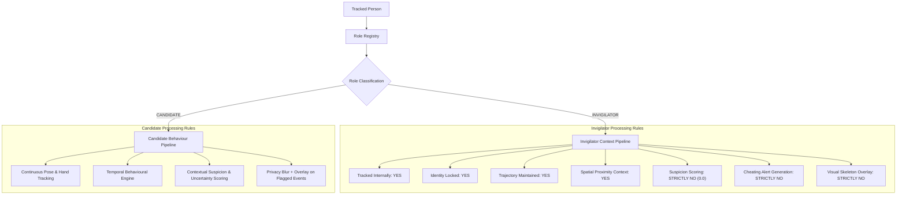
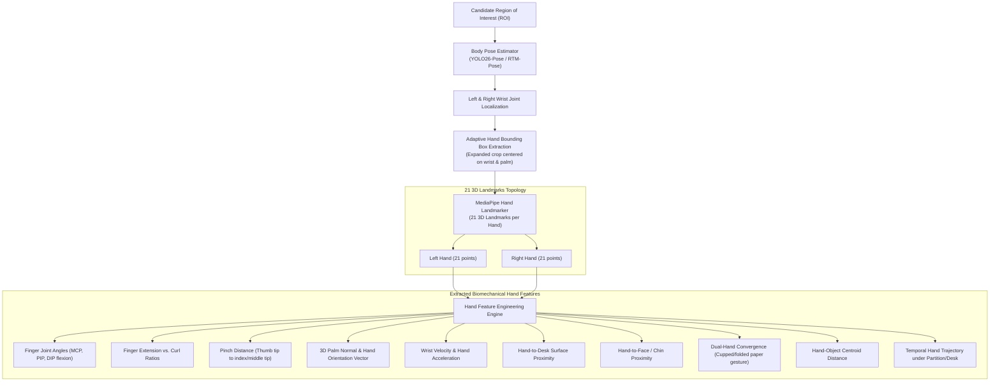
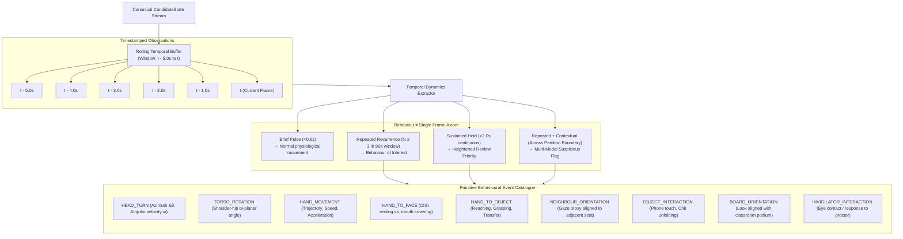
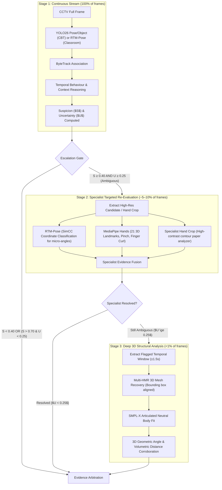

# DrishtiAI / NETRA-4D — Final Master System Architecture

> **Document Version**: 2.1 (Production Blueprint)  
> **Classification**: Core AI/Computer Vision Specification  
> **Status**: Frozen Specification for Implementation

---

## 1. Executive Master Flowchart

The complete end-to-end processing pipeline operates across four strictly decoupled architectural layers:
1. **Environment + Identity Layer**
2. **Adaptive Vision Layer**
3. **Temporal Behaviour + Uncertainty Layer**
4. **Evidence + Privacy Layer**

```mermaid
flowchart TD
    CCTV["🎥 CCTV / IP CAMERAS\n(RTSP / Recorded Video)"]
    INGEST["📥 VIDEO INGESTION\n(Decode / Resize / Timestamps / Quality Gate)"]
    ENV["🏢 1. ENVIRONMENT PROFILING\n(Opening Frames Warmup)"]

    CCTV --> INGEST --> ENV

    subgraph ENV_DISPATCH["Environment-Adaptive Vision Dispatch"]
        direction LR
        CBT_LAB["🖥️ CBT / COMPUTER LAB\n(~20–40 candidates, workstation monitors)"]
        CLASSROOM["🏫 LARGE CLASSROOM\n(~40–80+ students, dense seating)"]
    end

    ENV --> CBT_LAB
    ENV --> CLASSROOM

    subgraph CBT_STACK["CBT Primary Stack"]
        YOLO_OBJ["YOLO26 Object Detection\n(Monitors, Phones, Books, Hardware)"]
        YOLO_POSE["YOLO26-Pose\n(17 COCO Keypoints)"]
        BYTETRACK_CBT["ByteTrack\n(IoU + Re-ID Tracking)"]
        YOLO_OBJ --> YOLO_POSE --> BYTETRACK_CBT
    end

    subgraph CLASS_STACK["Classroom Primary Stack"]
        RTMPOSE_DENSE["RTM-Pose Dense Multi-Person Pose\n(SimCC Coordinate Classification)"]
        TRACKING_CLASS["Multi-Person Robust Tracking\n(Dense Crowd Association)"]
        RTMPOSE_DENSE --> TRACKING_CLASS
    end

    CBT_LAB --> YOLO_OBJ
    CLASSROOM --> RTMPOSE_DENSE

    PERSON_TRACKS["👤 PERSON TRACKS\n(Persistent Temporal Track IDs)"]
    BYTETRACK_CBT --> PERSON_TRACKS
    TRACKING_CLASS --> PERSON_TRACKS

    subgraph ROLE_DISCOVERY["🔒 2. ROLE & IMMUTABLE IDENTITY LAYER"]
        direction TB
        ROLE_CHECK{"Initial Role Discovery\n(Opening frames trajectory & posture)"}
        INVIG_LOCK["INVIGILATOR 🔒\n(Role Locked | Identity Locked)"]
        CAND_ASSIGN["CANDIDATE_XX 🔒\n(Assigned Candidate ID)"]
        DESK_LOCK["DESK / SEAT BINDING 🔒\n(1-to-1 Spatial Lock)"]
        DEV_LOCK["LAPTOP / WORKSTATION 🔒\n(Device Mapping)"]

        ROLE_CHECK -->|"Standing / Roaming"| INVIG_LOCK
        ROLE_CHECK -->|"Seated / Stationary"| CAND_ASSIGN --> DESK_LOCK --> DEV_LOCK
    end

    PERSON_TRACKS --> ROLE_DISCOVERY

    INVIG_CTX["INVIGILATOR CONTEXT ENGINE\n(Tracked internally for scene context;\nZero suspicion overlays; Zero cheating alerts)"]
    INVIG_LOCK --> INVIG_CTX

    CAND_STATE["📦 3. NORMALIZED CANDIDATE STATE\n(Model-Agnostic Abstraction)"]
    DEV_LOCK --> CAND_STATE

    subgraph MULTIMODAL_PERCEPTION["Multi-Modal Candidate Perception"]
        direction LR
        BODY_PERC["🦴 BODY POSE\n(YOLO26-Pose / RTM-Pose)"]
        HAND_PERC["✋ DETAILED HAND PIPELINE\n(MediaPipe Hands: 21 3D Landmarks/Hand)"]
        OBJ_PERC["📦 OBJECTS & CONTEXT\n(Detected Hardware / Phone / Paper)"]
    end

    CAND_STATE --> BODY_PERC
    CAND_STATE --> HAND_PERC
    CAND_STATE --> OBJ_PERC

    SEMANTIC_ZONES["🗺️ SEMANTIC CONTEXT ENGINE\n(Desk | Neighbour | Board | Invigilator | Entrance | Blind Spot)"]
    BODY_PERC --> SEMANTIC_ZONES
    HAND_PERC --> SEMANTIC_ZONES
    OBJ_PERC --> SEMANTIC_ZONES
    INVIG_CTX -.->|"Spatial Proximity Context"| SEMANTIC_ZONES

    TEMP_BUFFER["⏳ 4. TEMPORAL BEHAVIOURAL BUFFER\n(Observation History: t-5, t-4, t-3, t-2, t-1, t)"]
    SEMANTIC_ZONES --> TEMP_BUFFER

    subgraph TEMPORAL_FEATURES["Temporal Feature Extraction & Dynamics"]
        direction LR
        FEAT_DUR["⏱️ DURATION\n(Brief vs. Sustained)"]
        FEAT_REP["🔁 REPETITION\n(Frequency & recurrence count)"]
        FEAT_PERS["📌 PERSISTENCE\n(Continuous unbroken state)"]
    end

    TEMP_BUFFER --> FEAT_DUR
    TEMP_BUFFER --> FEAT_REP
    TEMP_BUFFER --> FEAT_PERS

    BEH_EVENTS["⚡ BEHAVIOUR EVENTS GENERATION\n(HEAD_TURN, HAND_TO_OBJECT, NEIGHBOUR_ORIENTATION, etc.)"]
    FEAT_DUR --> BEH_EVENTS
    FEAT_REP --> BEH_EVENTS
    FEAT_PERS --> BEH_EVENTS

    FUSION_ENGINE["🧠 BEHAVIOUR FUSION ENGINE"]
    BEH_EVENTS --> FUSION_ENGINE

    subgraph DUAL_METRICS["Dual Independent Metrics"]
        direction LR
        METRIC_SUSP["🔴 SUSPICIOUSNESS\n('Does this pattern matter?')"]
        METRIC_UNCERT["🟡 UNCERTAINTY\n('Do we clearly understand what happened?')"]
    end

    FUSION_ENGINE --> METRIC_SUSP
    FUSION_ENGINE --> METRIC_UNCERT

    ESCALATION_GATE{"⚖️ 5. ESCALATION GATE\n(Uncertainty vs. Suspicion Routing)"}
    METRIC_SUSP --> ESCALATION_GATE
    METRIC_UNCERT --> ESCALATION_GATE

    subgraph THREE_STAGE_ESCALATION["Multi-Stage Precision Escalation"]
        STAGE1["STAGE 1: Continuous Stream\n(YOLO26 / RTM-Pose + MediaPipe)"]
        STAGE2["STAGE 2: Specialist Targeted Re-Evaluation\n(RTM-Pose SimCC Sub-Pixel / Zoomed MediaPipe / Chit Crops)"]
        STAGE3["STAGE 3: Deep 3D Structural Analysis\n(Conditional Multi-HMR + SMPL-X 3D Mesh Recovery)"]
        
        STAGE2 -->|"Ambiguity Persists"| STAGE3
    end

    ESCALATION_GATE -->|"Confident Normal / Flagged"| ARBITRATION["⚖️ 6. EVIDENCE ARBITRATION ENGINE"]
    ESCALATION_GATE -->|"High Uncertainty / Ambiguous"| STAGE2
    STAGE2 -->|"Resolved with High Confidence"| ARBITRATION
    STAGE3 --> ARBITRATION

    subgraph ARBITRATION_INPUTS["Multi-Source Evidence Aggregation"]
        direction LR
        EVID_SUPP["✅ Supporting Evidence\n(Multi-model agreement, temporal hold)"]
        EVID_COUNT["⛔ Counter-Evidence\n(Board context, invigilator presence, natural baseline)"]
        EVID_HYPO["🔀 Competing Hypotheses\n(H1: Screen glance, H2: Board look, H3: Noise)"]
    end

    ARBITRATION --> EVID_SUPP
    ARBITRATION --> EVID_COUNT
    ARBITRATION --> EVID_HYPO

    FINAL_DECISION{"7. FINAL ARBITRATED STATE"}
    EVID_SUPP --> FINAL_DECISION
    EVID_COUNT --> FINAL_DECISION
    EVID_HYPO --> FINAL_DECISION

    subgraph AUDITABLE_STATES["Auditable Review States"]
        direction LR
        STATE_NORM["🟢 NORMAL\n(Routine Candidate Baseline)"]
        STATE_REV["🟡 REVIEW\n(Supervised Human Re-check)"]
        STATE_HIGH["🔴 HIGH PRIORITY REVIEW\n(Multi-Modal Corroborated Flag)"]
        STATE_INSUF["⚪ INSUFFICIENT EVIDENCE\n(Flag suppressed due to occlusion/uncertainty)"]
    end

    FINAL_DECISION --> STATE_NORM
    FINAL_DECISION --> STATE_REV
    FINAL_DECISION --> STATE_HIGH
    FINAL_DECISION --> STATE_INSUF

    EVIDENCE_GEN["📑 EVIDENCE & PROVENANCE GENERATOR\n(Structured BehaviourEvent Record, Keyframes, Clips, JSONL Audit)"]
    STATE_REV --> EVIDENCE_GEN
    STATE_HIGH --> EVIDENCE_GEN

    subgraph PRIVACY_RENDER["🛡️ 8. PRIVACY-SAFE RENDERER"]
        direction LR
        FACE_BLUR["😶‍🌫️ Common Head / Face Blur\n(Applied to Candidates & Invigilators)"]
        OVERLAY_ENG["📊 Selective Visual Overlay Engine\n(Candidate ID, Desk ID, Evidence Tags, 3D Mesh only if flagged)"]
    end

    EVIDENCE_GEN --> PRIVACY_RENDER
    PRIVACY_RENDER --> FACE_BLUR
    PRIVACY_RENDER --> OVERLAY_ENG

    DASHBOARD["💻 INVIGILATOR TELEMETRY DASHBOARD\n(Graph Timeline, Synchronized Video Player, Reviewer Sign-off)"]
    FACE_BLUR --> DASHBOARD
    OVERLAY_ENG --> DASHBOARD
```



---

## 2. Layer 1: Environment + Identity Layer

### 2.1 Video Ingestion & Environment Profiling
The system auto-profiles the physical space during opening frames (warmup period, e.g., 30–60 frames) to select the appropriate vision pathway:

```text
╔══════════════════════════════════════════════════════════════════════╗
║                         VIDEO / SCENE INPUT                         ║
╚══════════════════════════════════╤═══════════════════════════════════╝
                                   │
                                   ▼
                         ┌─────────────────────┐
                         │ CCTV / IP CAMERAS   │
                         │ RTSP / Recorded     │
                         └──────────┬──────────┘
                                    │
                                    ▼
                         ┌─────────────────────┐
                         │ VIDEO INGESTION     │
                         │ Decode / Resize /   │
                         │ Timestamp / Quality │
                         └──────────┬──────────┘
                                    │
                                    ▼
╔══════════════════════════════════════════════════════════════════════╗
║                    1. ENVIRONMENT PROFILING                         ║
╚══════════════════════════════════╤═══════════════════════════════════╝
                                   │
                    ┌──────────────┴──────────────┐
                    │                             │
                    ▼                             ▼
          ┌──────────────────┐          ┌─────────────────────┐
          │ CBT / COMPUTER   │          │ LARGE CLASSROOM     │
          │ LAB              │          │ 40–60 / 70–80+      │
          │                  │          │ students            │
          │ Workstations     │          │ Dense seating       │
          └────────┬─────────┘          └──────────┬──────────┘
```

* **CBT / Computer Lab**: Characterized by stationary monitors, partitions, keyboards, and mice. Primary detector: YOLO26 Object + YOLO26-Pose.
* **Large Written Classroom**: Characterized by dense benches/desks, high mutual occlusion, and handwritten papers. Primary detector: RTM-Pose (SimCC coordinate classification).

---

### 2.2 The Immutable Identity Rule (System Invariant)

Role discovery executes during the warmup phase. Individuals moving continuously along aisles with vertical displacement exceeding threshold $D_{roam}$ are registered as **INVIGILATOR**. Stationary individuals seated at desks are registered as **CANDIDATE**.

Once finalized, identity and bindings become **mathematically immutable**:

```text
INVIGILATOR
    │
    ├── Track ID       🔒
    ├── Role           🔒 INVIGILATOR
    └── Identity       🔒
```

And for seated candidates:

```text
CANDIDATE_07
    │
    ├── Track ID       🔒
    ├── Candidate ID   🔒
    ├── Seat / Desk    🔒
    └── Laptop / PC    🔒
```

#### The Recovery Invariant:
> **The system may lose a track temporarily due to occlusion or passing persons, but it may NOT silently reassign or swap the identity or workstation mapping.**

If track re-association fails after an occlusion exit:
$$\text{State} \rightarrow \text{IDENTITY\_UNCERTAIN}$$
It does **not** create a spurious new candidate.

---

### 2.3 Invigilator Exclusion & Context Architecture



---

## 3. Layer 2: Adaptive Vision Layer

### 3.1 Unified Canonical Candidate State
All perception models (YOLO26, RTM-Pose, MediaPipe) feed into a single model-agnostic `CandidateState` dataclass:

```text
                         CANDIDATE STATE
                               │
       ┌───────────────────────┼───────────────────────┐
       │                       │                       │
       ▼                       ▼                       ▼
   IDENTITY                  BODY                   OBJECTS
       │                       │                       │
 Candidate_ID             YOLO26/RTM             YOLO26 objects
 Track_ID                  keypoints              confidence
 Seat_ID
 Workstation_ID
       │                       │                       │
       └───────────────────────┼───────────────────────┘
                               │
                               ▼
                       VISIBILITY STATE
                               │
                     ┌─────────┼─────────┐
                     │         │         │
                  visible   occluded   lost
                     │
                     ▼
                  TRACKING
                 CONFIDENCE
```

---

### 3.2 Body + Detailed Hand Pipeline (MediaPipe Hands)

For subtle examination interactions (concealing a paper chit, palm notes, phone handling under the desk), full-body skeletons are insufficient. The hand subsystem extracts localized wrist/hand ROIs and processes them with **MediaPipe Hands**:



This transforms observations from simple presence (*"There is a hand"*) into precise forensic action (*"Candidate_12 right hand formed a pinch configuration holding a 2.4cm reflective boundary under desk for 1.6 seconds"*).

---

## 4. Layer 3: Temporal Behaviour + Uncertainty Layer

### 4.1 Semantic Context Layer
Candidate keypoints and hand interactions are mapped against pre-calibrated or auto-profiled spatial regions:

```text
                         CANDIDATE
                            │
                            ▼
                   SEMANTIC ZONE ENGINE
                            │
       ┌────────────┬───────┼──────────┬──────────────┐
       ▼            ▼       ▼          ▼              ▼
     DESK        NEIGHBOUR BOARD    INVIGILATOR     ENTRANCE
                             │
                             ▼
                         BLIND SPOT
```

#### Spatial Disambiguation Matrix:
* **Head Turn + Board Zone**: Normal attention to proctor/blackboard instructions $\rightarrow$ Counter-evidence to suspicion.
* **Head Turn + Neighbour Workstation + Sustained (>2.5s) + Repeated ($\ge 3\times$)**: Neighbour screen glance $\rightarrow$ Elevated review priority.
* **Hand Descent + Under-Desk Zone + High Pinch Confidence**: Retrieval behavior $\rightarrow$ Trigger Stage 2 Specialist Hand Crop.

---

### 4.2 Temporal Behavioural Engine & Buffer Dynamics



---

### 4.3 Suspicion vs. Uncertainty Separation

The behavioral engine outputs two mathematically orthogonal dimensions:

```text
                         EVENT
                           │
              ┌────────────┴────────────┐
              ▼                         ▼
        SUSPICIOUSNESS              UNCERTAINTY
              │                         │
        "Does this matter?"       "Do we understand
                                   what happened?"
              │                         │
              └────────────┬────────────┘
                           ▼
                    ESCALATION GATE
```

#### Decision Matrix:

| Suspiciousness | Uncertainty | System Routing | Action Taken |
|---|---|---|---|
| **HIGH** | **LOW** | Confident Review | Generate High Priority Review Event with supporting video clip |
| **HIGH** | **HIGH** | Ambiguous Event | Escalate to **Stage 2 Specialist** (or Stage 3 Multi-HMR) |
| **LOW** | **HIGH** | Noise / Occlusion | Suppress alert; mark state as `INSUFFICIENT_EVIDENCE` |
| **LOW** | **LOW** | Routine Baseline | Normal candidate operation; drop from alert queue |

---

### 4.4 Three-Stage Precision Escalation Pipeline



---

## 5. Layer 4: Evidence + Privacy Layer

### 5.1 Evidence Arbitration Engine
Arbitration fuses all positive signals, negative context, and alternative explanations into a defensible outcome:

```text
YOLO26 / RTM Evidence
          +
Hand Evidence (MediaPipe)
          +
Temporal Evidence (Duration, Repetition, Persistence)
          +
Object Evidence (Phone, Chit, Hardware)
          +
Semantic Context (Workstation, Neighbour, Board, Aisle)
          +
Specialist Evidence (Stage 2 SimCC / Wrist Crop)
          +
3D Structural Corroboration (Stage 3 Multi-HMR)
          +
Counter-Evidence (Board look, invigilator presence, normal mouse use)
          +
Competing Hypotheses (H1, H2, H3, H4, H5)
          │
          ▼
┌───────────────────────────┐
│    EVIDENCE ARBITRATION   │
└─────────────┬─────────────┘
              ▼
        FINAL EVENT STATE
```

---

### 5.2 Competing Hypotheses & Counter-Evidence Framework
Every incident maintains explicit competing hypotheses:
* **$H_1$ (Primary Suspicion)**: Looking at neighbour's examination paper/screen.
* **$H_2$ (Environmental)**: Looking at instruction blackboard or wall clock.
* **$H_3$ (Personnel)**: Acknowledging an approaching invigilator.
* **$H_4$ (Ergonomic)**: Natural stretching / posture reset.
* **$H_5$ (Sensor Noise)**: Keypoint jitter or tracker association ambiguity.

Each incoming observation adjusts the probability mass across $H_1 \dots H_5$. Counter-evidence is preserved in the audit log and **never discarded**.

---

### 5.3 Canonical BehaviourEvent Data Contract

```python
class BehaviourEvent(BaseModel):
    schema_version: str = "2.1.0"
    event_id: str                      # Unique UUIDv4 event identifier
    candidate_id: str                  # e.g., "Candidate_12" (Immutable)
    track_id: int                      # Tracker internal ID
    seat_id: str                       # e.g., "Seat_12"
    workstation_id: Optional[str]      # e.g., "Desk_12_PC_A"
    
    start_timestamp_sec: float         # Event start time
    end_timestamp_sec: float           # Event end time
    duration_sec: float                # Event temporal duration
    
    behaviour_type: str                # e.g., "NEIGHBOUR_SCREEN_GLANCE", "CHIT_RETRIEVAL"
    semantic_zone: str                 # e.g., "NEIGHBOUR_DESK", "UNDER_DESK"
    target_candidate_id: Optional[str] # If cross-candidate interaction
    
    pose_evidence: Dict[str, Any]      # Extracted keypoints & angular deviations
    hand_evidence: Dict[str, Any]      # MediaPipe 21-point landmarks & pinch metrics
    object_evidence: Dict[str, Any]    # Detected objects, bounding boxes, confidences
    temporal_evidence: Dict[str, Any]  # Duration, repetition count in 90s window
    context_evidence: Dict[str, Any]   # Invigilator distance, board alignment
    
    supporting_evidence: List[str]     # Multi-model corroboration points
    counter_evidence: List[str]        # Neutralizing factors (e.g. board context)
    competing_hypotheses: Dict[str, float] # Likelihood distribution {H1: 0.72, H2: 0.15, ...}
    
    suspicion_score: float             # [0.0, 1.0] Forensic priority
    confidence: float                  # [0.0, 1.0] Model certainty
    uncertainty: float                 # [0.0, 1.0] Measurement entropy
    uncertainty_reason: Optional[str]  # e.g., "Partial wrist occlusion"
    
    models_used: List[str]             # e.g., ["YOLO26-Pose", "MediaPipe-Hands", "Multi-HMR"]
    escalation_stage: int              # 1 (Continuous), 2 (Specialist), 3 (Deep 3D)
    
    final_status: str                  # NORMAL | REVIEW | HIGH_PRIORITY_REVIEW | INSUFFICIENT_EVIDENCE
```

---

### 5.4 Privacy-Safe Rendering Engine

The visual display enforces clear boundaries:

```text
                     FINAL EVENT
                         │
                         ▼
                 EVIDENCE GENERATOR
                         │
             ┌───────────┼───────────┐
             ▼           ▼           ▼
          Keyframes    Timeline    Clip
                         │
                         ▼
                 PRIVACY RENDERER
                         │
                  ┌──────┴──────┐
                  ▼             ▼
              FACE/HEAD      OVERLAYS
                 BLUR
                  │
                  ▼
             FINAL OUTPUT
```

* **Common Rule**: Face/head blur is applied to **everyone** (candidates and invigilators alike) to prevent biometric privacy violations.
* **Candidate Display**: Displays bounding tag (`Candidate_XX -> Desk_YY`), gaze direction vector, hand interaction circles, and (only during `REVIEW`/`HIGH_PRIORITY_REVIEW`) the 3D SMPL-X mesh wireframe.
* **Invigilator Display**:
  ```text
       [blurred face]
            👤
  
     No bounding box
     No candidate ID
     No pose skeleton
     No suspicion overlay
     No standing-person annotation
  ```

---

## 6. The Five Foundational Invariants

1. **Environment Adaptive**: CBT labs and large written classrooms execute distinct primary perception models based on opening frame profiling.
2. **Identity Immutable**: Once `Invigilator`, `Candidate_XX`, `Desk`, and `Workstation` are locked, mappings cannot swap or re-assign during the session.
3. **Invigilator Excluded from Suspicion**: Invigilators are tracked for environmental context, but are mathematically barred from receiving suspicion scores or visual overlays.
4. **Uncertainty Triggers Escalation, Not Accusation**: High uncertainty routes candidates to Stage 2 specialists or Stage 3 3D recovery rather than manufacturing false alerts.
5. **Auditable Evidence is the Output**: The system never outputs a boolean *"Cheating: True"*; it generates an auditable evidence package with competing hypotheses for invigilator review.

---

## 7. Master Codebase Traceability Matrix

Every element in this architecture is mapped directly to its corresponding module in the codebase:

| Architecture Component | Subsystem / Layer | Source File Path |
|---|---|---|
| **Video Ingestion** | Ingestion & IO | [`src/drishti/data/google_drive.py`](file:///c:/Users/bhavv/OneDrive/Desktop/Dravvya(4th%20Sem)/Hackathons/NETRA-4D/src/drishti/data/google_drive.py) |
| **Quality Gate** | Ingestion & IO | [`src/drishti/engine/observation.py`](file:///c:/Users/bhavv/OneDrive/Desktop/Dravvya(4th%20Sem)/Hackathons/NETRA-4D/src/drishti/engine/observation.py) |
| **Environment Profiler** | Layer 1: Environment | [`src/drishti/pipeline/environment.py`](file:///c:/Users/bhavv/OneDrive/Desktop/Dravvya(4th%20Sem)/Hackathons/NETRA-4D/src/drishti/pipeline/environment.py) |
| **Immutable Role Registry** | Layer 1: Identity | [`src/drishti/pipeline/role_registry.py`](file:///c:/Users/bhavv/OneDrive/Desktop/Dravvya(4th%20Sem)/Hackathons/NETRA-4D/src/drishti/pipeline/role_registry.py) |
| **Immutable Candidate Registry** | Layer 1: Identity | [`src/drishti/pipeline/candidate_registry.py`](file:///c:/Users/bhavv/OneDrive/Desktop/Dravvya(4th%20Sem)/Hackathons/NETRA-4D/src/drishti/pipeline/candidate_registry.py) |
| **YOLO26 Vision Provider** | Layer 2: Adaptive Vision | [`src/drishti/providers/yolo26_provider.py`](file:///c:/Users/bhavv/OneDrive/Desktop/Dravvya(4th%20Sem)/Hackathons/NETRA-4D/src/drishti/providers/yolo26_provider.py) |
| **RTM-Pose Specialist Provider** | Layer 2 & Stage 2 | [`src/drishti/engine/escalation.py`](file:///c:/Users/bhavv/OneDrive/Desktop/Dravvya(4th%20Sem)/Hackathons/NETRA-4D/src/drishti/engine/escalation.py) |
| **Canonical Candidate State** | Layer 2: Adaptive Vision | [`src/drishti/engine/candidate_state.py`](file:///c:/Users/bhavv/OneDrive/Desktop/Dravvya(4th%20Sem)/Hackathons/NETRA-4D/src/drishti/engine/candidate_state.py) |
| **MediaPipe Hands Specialist** | Layer 2 & Stage 2 | [`src/drishti/engine/escalation.py`](file:///c:/Users/bhavv/OneDrive/Desktop/Dravvya(4th%20Sem)/Hackathons/NETRA-4D/src/drishti/engine/escalation.py) |
| **Specialist Hand & Chit Crop** | Stage 2 Specialist | [`src/drishti/pipeline/specialist_crop.py`](file:///c:/Users/bhavv/OneDrive/Desktop/Dravvya(4th%20Sem)/Hackathons/NETRA-4D/src/drishti/pipeline/specialist_crop.py) |
| **Semantic Context & Zones** | Layer 3: Temporal Behaviour | [`src/drishti/engine/zones.py`](file:///c:/Users/bhavv/OneDrive/Desktop/Dravvya(4th%20Sem)/Hackathons/NETRA-4D/src/drishti/engine/zones.py) |
| **Temporal Buffer Engine** | Layer 3: Temporal Behaviour | [`src/drishti/engine/temporal_buffer.py`](file:///c:/Users/bhavv/OneDrive/Desktop/Dravvya(4th%20Sem)/Hackathons/NETRA-4D/src/drishti/engine/temporal_buffer.py) |
| **Signal Smoothing & Outliers** | Layer 3: Temporal Behaviour | [`src/drishti/engine/smoothing.py`](file:///c:/Users/bhavv/OneDrive/Desktop/Dravvya(4th%20Sem)/Hackathons/NETRA-4D/src/drishti/engine/smoothing.py) |
| **Biomechanical Features** | Layer 3: Temporal Behaviour | [`src/drishti/engine/features.py`](file:///c:/Users/bhavv/OneDrive/Desktop/Dravvya(4th%20Sem)/Hackathons/NETRA-4D/src/drishti/engine/features.py) |
| **Primitive Events Extractor** | Layer 3: Temporal Behaviour | [`src/drishti/engine/primitive_events.py`](file:///c:/Users/bhavv/OneDrive/Desktop/Dravvya(4th%20Sem)/Hackathons/NETRA-4D/src/drishti/engine/primitive_events.py) |
| **Temporal Patterns (Duration/Rep)** | Layer 3: Temporal Behaviour | [`src/drishti/engine/temporal_patterns.py`](file:///c:/Users/bhavv/OneDrive/Desktop/Dravvya(4th%20Sem)/Hackathons/NETRA-4D/src/drishti/engine/temporal_patterns.py) |
| **Competing Hypotheses & Counter-Ev** | Layer 3: Temporal Behaviour | [`src/drishti/engine/hypotheses.py`](file:///c:/Users/bhavv/OneDrive/Desktop/Dravvya(4th%20Sem)/Hackathons/NETRA-4D/src/drishti/engine/hypotheses.py) |
| **Escalation Gate** | Stage 1 / 2 / 3 Router | [`src/drishti/engine/escalation.py`](file:///c:/Users/bhavv/OneDrive/Desktop/Dravvya(4th%20Sem)/Hackathons/NETRA-4D/src/drishti/engine/escalation.py) |
| **Multi-HMR & SMPL-X 3D Mesh** | Stage 3 Deep Analysis | [`third_party/multi-hmr/`](file:///c:/Users/bhavv/OneDrive/Desktop/Dravvya(4th%20Sem)/Hackathons/NETRA-4D/third_party/multi-hmr) |
| **Evidence Arbitrator** | Layer 4: Evidence | [`src/drishti/pipeline/arbitrator.py`](file:///c:/Users/bhavv/OneDrive/Desktop/Dravvya(4th%20Sem)/Hackathons/NETRA-4D/src/drishti/pipeline/arbitrator.py) |
| **Candidate State Machine** | Layer 4: Evidence | [`src/drishti/engine/state_machine.py`](file:///c:/Users/bhavv/OneDrive/Desktop/Dravvya(4th%20Sem)/Hackathons/NETRA-4D/src/drishti/engine/state_machine.py) |
| **Event Contracts & Schemas** | Layer 4: Evidence | [`src/drishti/events.py`](file:///c:/Users/bhavv/OneDrive/Desktop/Dravvya(4th%20Sem)/Hackathons/NETRA-4D/src/drishti/events.py) |
| **SQLite Audit & Repository** | Layer 4: Evidence | [`src/drishti/event_repository.py`](file:///c:/Users/bhavv/OneDrive/Desktop/Dravvya(4th%20Sem)/Hackathons/NETRA-4D/src/drishti/event_repository.py) |
| **Privacy-Safe Face Masking** | Layer 4: Privacy Renderer | [`src/drishti/privacy.py`](file:///c:/Users/bhavv/OneDrive/Desktop/Dravvya(4th%20Sem)/Hackathons/NETRA-4D/src/drishti/privacy.py) |
| **Telemetry Dashboard & REST API** | UI & Verification | [`src/drishti/api/app.py`](file:///c:/Users/bhavv/OneDrive/Desktop/Dravvya(4th%20Sem)/Hackathons/NETRA-4D/src/drishti/api/app.py) |
| **Unified Pipeline Runner** | End-to-End Orchestrator | [`scripts/run_situational_pipeline.py`](file:///c:/Users/bhavv/OneDrive/Desktop/Dravvya(4th%20Sem)/Hackathons/NETRA-4D/scripts/run_situational_pipeline.py) |
